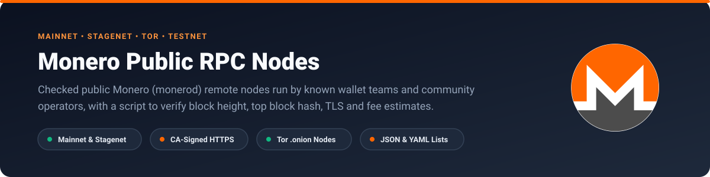
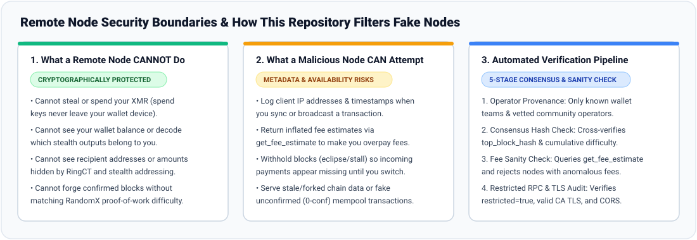

<p align="center">
  
</p>

# Monero Public RPC Nodes (Mainnet & Stagenet) [](https://github.com/90ssolo/monero-rpc-nodes/actions/workflows/validate.yml) [](LICENSE)

Public **Monero (`monerod`) remote RPC nodes** for **Mainnet**, **Stagenet** and **Testnet**, along with a small Node.js script to check that each node is on the real chain, uses restricted RPC and returns normal fee estimates.

Scraped node lists often mix community-run servers with dozens of unnamed raw-IP cloud VPS instances that have the Monero Research Lab (MRL) ban list turned off or sit on stale forks. This repository only lists nodes run by known wallet projects, MRL contributors and established community operators, and separates nodes with valid CA-signed HTTPS certificates from plain HTTP or self-signed ports.

## Contents

- [Copy-paste node lists](#copy-paste-node-lists)
- [1. Mainnet - HTTPS nodes (CA-signed TLS)](#1-mainnet--https-nodes-ca-signed-tls)
- [2. Mainnet - HTTP and self-signed TLS nodes](#2-mainnet--http-and-self-signed-tls-nodes)
- [3. Stagenet - Clearnet nodes (for testing)](#3-stagenet--clearnet-nodes-for-testing)
- [4. Tor (`.onion`) nodes (Mainnet & Stagenet)](#4-tor-onion-nodes-mainnet--stagenet)
- [5. Testnet nodes](#5-testnet-nodes)
- [How fake and misconfigured nodes are filtered out](#how-fake-and-misconfigured-nodes-are-filtered-out)
- [Check the nodes yourself](#check-the-nodes-yourself)
- [JSON and YAML files](#json-and-yaml-files)
- [Related guides and projects](#related-guides-and-projects)

---

## Copy-paste node lists

### Mainnet HTTPS (valid TLS certificate - for web wallets, relays and payment servers)

```ini
MONERO_NODE_URLS=https://xmr-node.cakewallet.com:18081,https://node.sethforprivacy.com:443,https://node3.monerodevs.org:18089,https://node.monerodevs.org:18089,https://node2.monerodevs.org:18089,https://ravfx.its-a-node.org:18081,https://ravfx2.its-a-node.org:18089,https://xmr.cryptostorm.is:18081,https://xmr1.doggett.tech:18089,https://monero.stackwallet.com:18081
```

### Mainnet HTTPS with browser CORS (`Access-Control-Allow-Origin: *`)

```ini
MONERO_CORS_NODE_URLS=https://node.sethforprivacy.com:443,https://ravfx.its-a-node.org:18081,https://ravfx2.its-a-node.org:18089,https://xmr.cryptostorm.is:18081
```

### Stagenet (for testing wallets, checkouts and webhooks with free Stagenet XMR)

```ini
MONERO_STAGENET_NODE_URLS=http://node.sethforprivacy.com:38089,http://node3.monerodevs.org:38089,http://node.monerodevs.org:38089,http://node2.monerodevs.org:38089,http://stagenet.xmr-tw.org:38081,http://xmr-lux.boldsuck.org:38081
```

---

## 1. Mainnet - HTTPS nodes (CA-signed TLS)

These endpoints present a valid TLS certificate trusted by standard browsers and Node.js, run with `restricted_rpc: true`, and match the Mainnet top block hash (`4a9d7086922506d2...` at height `3786201`).

| Address | Operator | Region | TLS | Browser CORS | Restricted RPC |
|---|---|---|---|---|---|
| `https://xmr-node.cakewallet.com:18081` | Cake Wallet (cakewallet.com) | Global (GeoDNS) | CA-Signed Valid | None (Use server relay for browser apps) | `true` |
| `https://node.sethforprivacy.com:443` | Seth for Privacy (sethforprivacy.com) | North America / Anycast | CA-Signed Valid | Enabled (*) | `true` |
| `https://node.monerodevs.org:18089` | MoneroDevs Community | North America | CA-Signed Valid | None | `true` |
| `https://node2.monerodevs.org:18089` | MoneroDevs Community | North America | CA-Signed Valid | None | `true` |
| `https://node3.monerodevs.org:18089` | MoneroDevs Community | Europe | CA-Signed Valid | None | `true` |
| `https://ravfx.its-a-node.org:18081` | RavFX (Feather Wallet Curated) | Europe | CA-Signed Valid | Enabled (*) | `true` |
| `https://ravfx2.its-a-node.org:18089` | RavFX (Feather Wallet Curated) | Europe | CA-Signed Valid | Enabled (*) | `true` |
| `https://xmr.cryptostorm.is:18081` | Cryptostorm Privacy Network | North America | CA-Signed Valid | Enabled (*) | `true` |
| `https://xmr1.doggett.tech:18089` | Doggett Tech | North America | CA-Signed Valid | None | `true` |
| `https://monero.stackwallet.com:18081` | Stack Wallet / Cypher Stack | North America | CA-Signed Valid | None | `true` |

---

## 2. Mainnet - HTTP and self-signed TLS nodes

These nodes are run by known community operators (and appear in Feather Wallet's default `nodes.json` or pool infrastructure), but use plain `http://` or a self-signed certificate on their RPC port. They work in desktop/CLI wallets that accept self-signed certs, but will be rejected by browsers and strict HTTPS clients unless proxied.

> [!WARNING]
> Plain `http://` over the internet can be read or altered along the way. For real money over a remote node, prefer CA-signed `https://` (Section 1), Tor `.onion` (Section 4), or your own node.

| Address | Operator | Region | TLS / port note | Restricted RPC |
|---|---|---|---|---|
| `http://node.sethforprivacy.com:18089` | Seth for Privacy (sethforprivacy.com) | North America / Anycast | Self-Signed on 18089 (Use port 443 for CA-signed HTTPS) | `true` |
| `http://node3-us.monero.love:18081` | monero.love (Feather Wallet Curated) | North America (US) | Self-Signed TLS / HTTP | `true` |
| `http://rucknium.me:18081` | Rucknium (Monero Research Lab Contributor) | North America | Self-Signed TLS / HTTP | `true` |
| `http://xmr.stormycloud.org:18089` | StormyCloud Inc. (501(c)(3) Privacy Non-Profit) | North America (US) | Self-Signed TLS / HTTP | `true` |
| `http://xmr-de.boldsuck.org:18081` | Boldsuck (Tor & Monero Relay Operator) | Europe (Germany) | Custom CA / Self-Signed TLS | `true` |
| `http://opennode.xmr-tw.org:18089` | XMR-TW (Taiwan Monero Community) | Asia-Pacific (Taiwan) | Self-Signed TLS / HTTP | `true` |
| `http://nodes.hashvault.pro:18081` | HashVault Pool | Europe | Self-Signed TLS / HTTP | `true` |

---

## 3. Stagenet - Clearnet nodes (for testing)

Stagenet uses the same rules as Mainnet with free test coins. All endpoints below were checked against Stagenet block `2231362` (hash `78ffcdcfe29d170c...`, difficulty `0x39c8eb`).

| Address | Operator | Region | Port | Restricted RPC | Notes |
|---|---|---|---|---|---|
| `http://node.sethforprivacy.com:38089` | Seth for Privacy (sethforprivacy.com) | North America | `38089` | `true` | Official Feather Wallet default stagenet node; reliable for testing payment servers and wallets. |
| `http://xmr-lux.boldsuck.org:38081` | Boldsuck (Tor & Monero Relay Operator) | Europe (Luxembourg) | `38081` | `true` | Official Feather Wallet default stagenet node in Europe. |
| `http://node.monerodevs.org:38089` | MoneroDevs Community | North America | `38089` | `true` | MoneroDevs primary stagenet restricted RPC endpoint. |
| `http://node2.monerodevs.org:38089` | MoneroDevs Community | North America | `38089` | `true` | MoneroDevs secondary stagenet restricted RPC endpoint. |
| `http://node3.monerodevs.org:38089` | MoneroDevs Community | Europe | `38089` | `true` | Fast European stagenet restricted RPC node. |
| `http://stagenet.xmr-tw.org:38081` | XMR-TW (Taiwan Monero Community) | Asia-Pacific (Taiwan) | `38081` | `true` | Asia-Pacific stagenet RPC node operated by XMR-TW. |

---

## 4. Tor (`.onion`) nodes (Mainnet & Stagenet)

Using a node over Tor hides your IP address from the node operator and encrypts traffic end-to-end. These addresses come from Feather Wallet's [`src/assets/nodes.json`](https://raw.githubusercontent.com/feather-wallet/feather/master/src/assets/nodes.json) and Cake Wallet's documentation.

| Network | Onion address | Operator | Port |
|---|---|---|---|
| **MAINNET** | `http://cakexmrkbd7ptshw7vfzhzqgg77xgeavdrxm6zbu57lppfkj3fczbrqd.onion:18081` | Cake Wallet | `18081` |
| **MAINNET** | `http://loveanvthlsepingenr7opdqy6nlhn5jidwvzzxfmwsw2rry5mn2gfqd.onion:18089` | monero.love | `18089` |
| **MAINNET** | `http://plowsof3t5hogddwabaeiyrno25efmzfxyro2vligremt7sxpsclfaid.onion:18089` | Plowsof (Monero Community / CCS) | `18089` |
| **MAINNET** | `http://plowsoffjexmxalw73tkjmf422gq6575fc7vicuu4javzn2ynnte6tyd.onion:18089` | Plowsof (Monero Community / CCS) | `18089` |
| **MAINNET** | `http://plowsofe6cleftfmk2raiw5h2x66atrik3nja4bfd3zrfa2hdlgworad.onion:18089` | Plowsof (Monero Community / CCS) | `18089` |
| **MAINNET** | `http://ravfxmrqgd4j2o2gdc2yaij2wcmkcflu2rdnzhng5htk5hgnh6gmyeid.onion:18081` | RavFX | `18081` |
| **MAINNET** | `http://ravfxmrzi3eet62s4nkuu5sgpq6otgtffluk3ylb2kuvimtb34sonryd.onion:18089` | RavFX | `18089` |
| **MAINNET** | `http://rucknium757bokwv3ss35ftgc3gzb7hgbvvglbg3hisp7tsj2fkd2nyd.onion:18081` | Rucknium (MRL Contributor) | `18081` |
| **STAGENET** | `http://ct36dsbe3oubpbebpxmiqz4uqk6zb6nhmkhoekileo4fts23rvuse2qd.onion:38081` | Boldsuck | `38081` |
| **STAGENET** | `http://plowsof3t5hogddwabaeiyrno25efmzfxyro2vligremt7sxpsclfaid.onion:38089` | Plowsof (Monero Community / CCS) | `38089` |
| **STAGENET** | `http://plowsoffjexmxalw73tkjmf422gq6575fc7vicuu4javzn2ynnte6tyd.onion:38089` | Plowsof (Monero Community / CCS) | `38089` |

---

## 5. Testnet nodes

| Address | Operator | Port | Checked height | Block hash prefix |
|---|---|---|---|---|
| `http://node.sethforprivacy.com:28089` | Seth for Privacy (sethforprivacy.com) | `28089` | `3110132` | `bc4bc615f8802684...` |

---

## How fake and misconfigured nodes are filtered out

<p align="center">
  
</p>

A remote node never receives your private keys and cannot spend your coins or see your balance. What a bad node *can* do is log your IP address, lie about fee estimates, hold back blocks so payments look missing, or feed you unconfirmed transactions on a fake chain.

To keep those out, this list checks five things:

1. **No unnamed raw-IP servers.**
   Public node crawlers regularly pick up dozens of raw IPv4 addresses on cheap cloud hosts with the MRL spy-node ban list turned off. Because Sybil clusters use unnamed IP hosts to log wallet connections, `scripts/validate.mjs` rejects raw IP addresses. Every entry must have a domain name or `.onion` address and a known operator.
2. **Matching top block hash and difficulty.**
   `scripts/verify-live.mjs` calls `get_info` on every clearnet node and compares `height`, `top_block_hash` and `wide_difficulty` against independent operators (Cake Wallet, Seth for Privacy, MoneroDevs).
3. **Fee estimate check (`get_fee_estimate`).**
   A rogue node can return a huge number from `get_fee_estimate` so your wallet overpays miner fees. The check script flags any node whose fee estimate is out of line.
4. **Restricted RPC (`restricted: true`).**
   Public nodes must run with `--restricted-rpc` so unsafe daemon commands are turned off.
5. **Real HTTPS separated from self-signed ports.**
   Many nodes listen on `18081` or `18089` with a self-signed certificate (`DEPTH_ZERO_SELF_SIGNED_CERT`), which breaks browser wallets and standard `fetch()` calls. Only nodes with a valid certificate from a public CA are listed in Section 1.

---

## Check the nodes yourself

To ping every clearnet Mainnet, Stagenet and Testnet node from your own machine and check latency, TLS, CORS headers, block hashes and fee estimates:

```bash
npm install
npm run verify-live
```

To validate `data/nodes.yaml` and rebuild `data/nodes.json` and `README.md`:

```bash
npm test
npm run build
```

---

## JSON and YAML files

- **[`data/nodes.json`](data/nodes.json):** Plain JSON lists grouped under `mainnet.https`, `mainnet.http`, `mainnet.tor`, `stagenet.clearnet` and `stagenet.tor`, plus the full array of node records.
- **[`data/nodes.yaml`](data/nodes.yaml):** Source file with operator details, provenance links and checked block hashes.

---

## Related guides and projects

- **[Monero Remote Nodes: How to Choose and Use One Safely](https://monkstash.com/monero-remote-node):** What a remote node can and cannot see, when to use Tor, and what to do if a wallet will not sync.
- **[How to Run a Monero Node](https://monkstash.com/run-a-monero-node):** Setting up your own full or pruned `monerod` node.
- **[Awesome Monero Payments](https://github.com/90ssolo/awesome-monero-payments):** Comparison of Monero payment servers, browser tills, shop plugins and libraries.
- **[Monero Merchant Starter Kit](https://github.com/90ssolo/monero-merchant-starter-kit):** Printable counter cards, invoice templates, cashier checklist and refund guide.

## License

[CC0 1.0 Universal (Public Domain)](LICENSE).
